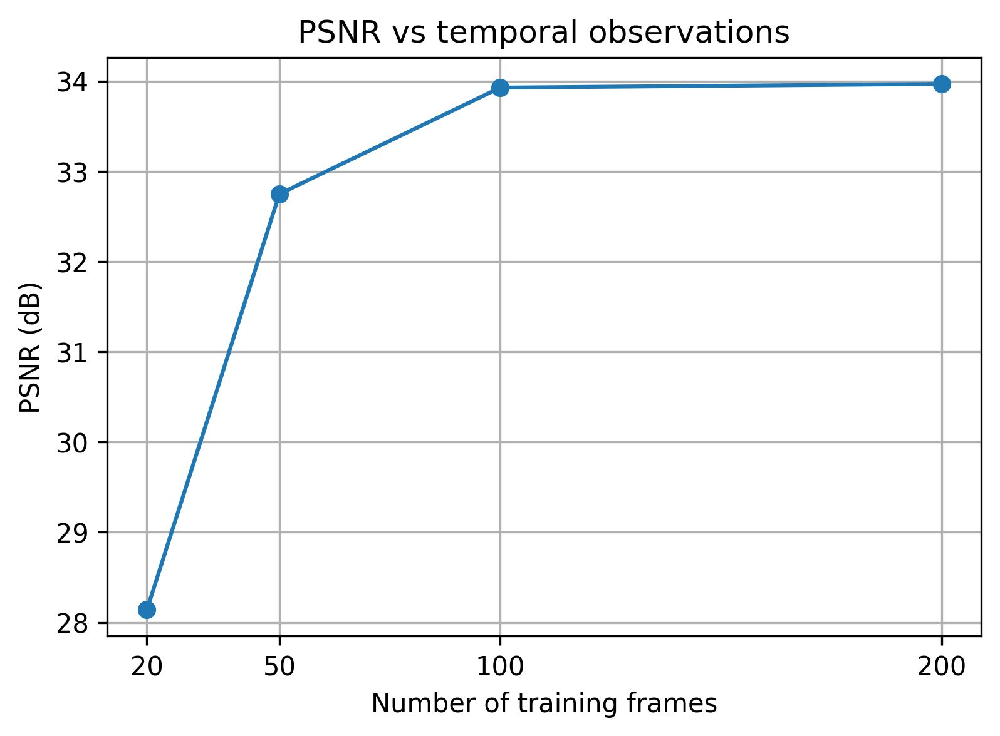
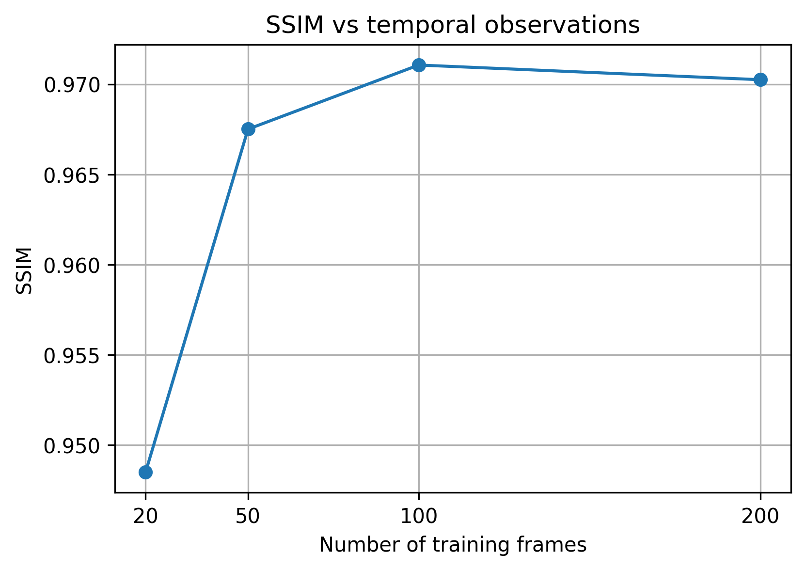
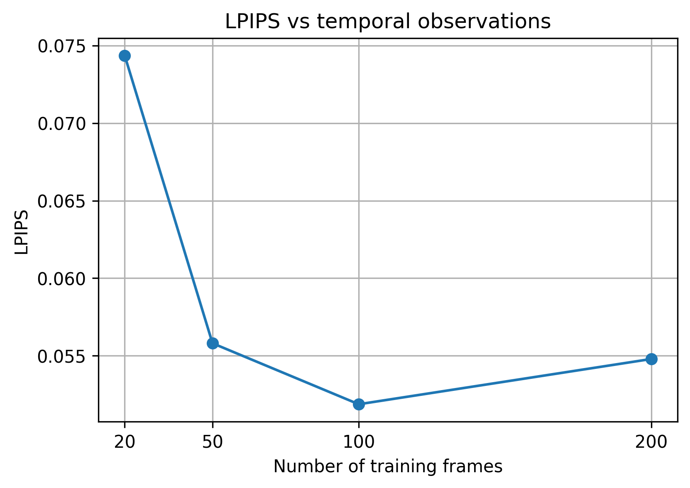
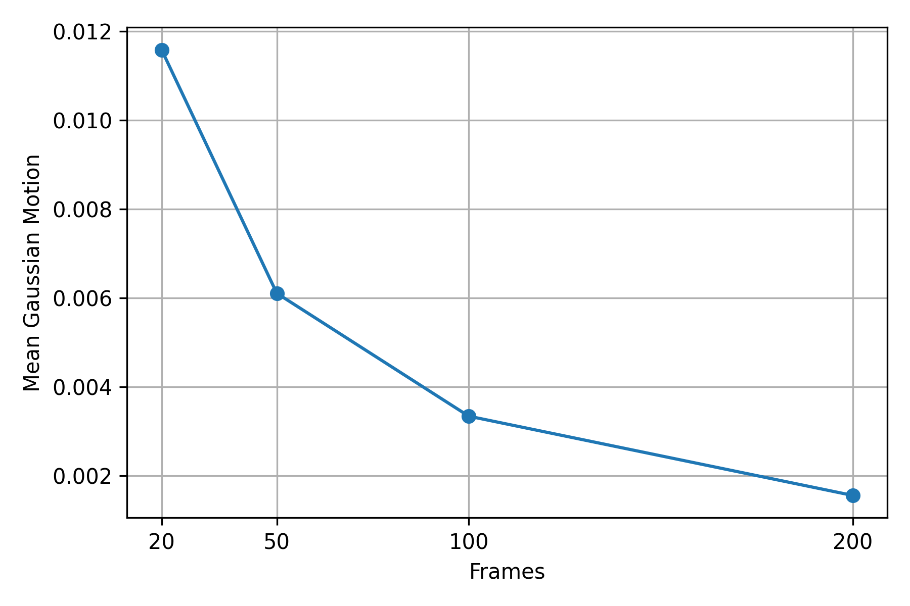
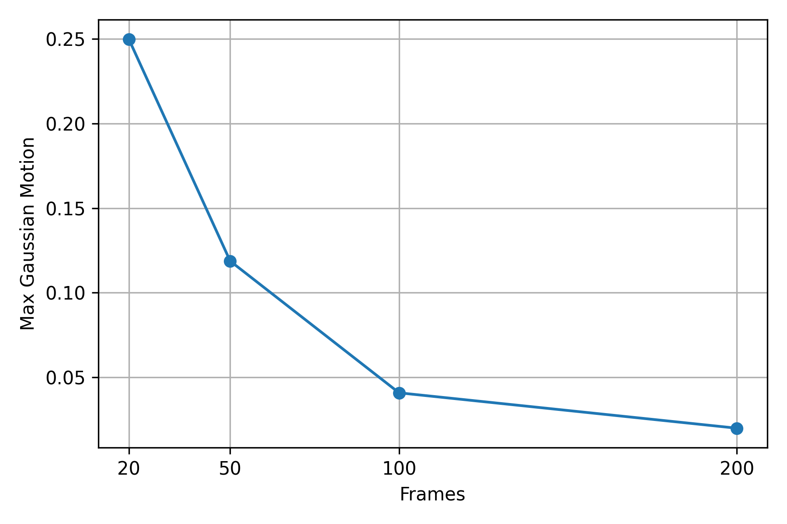
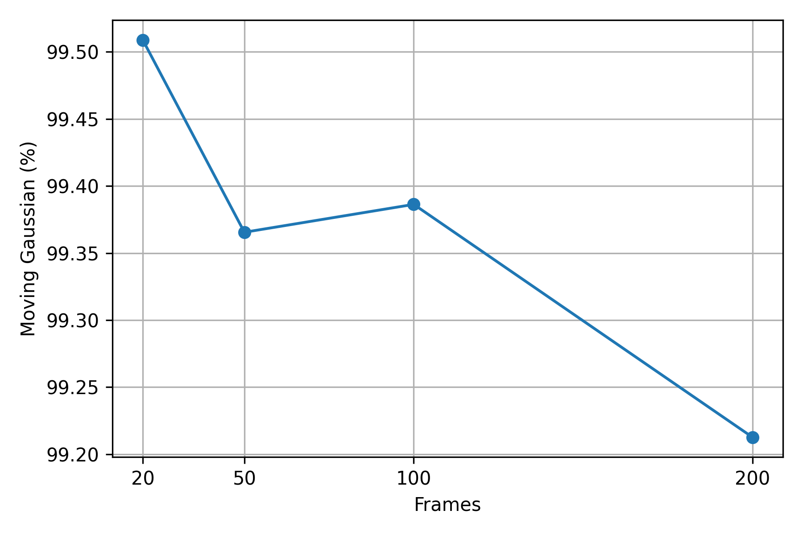
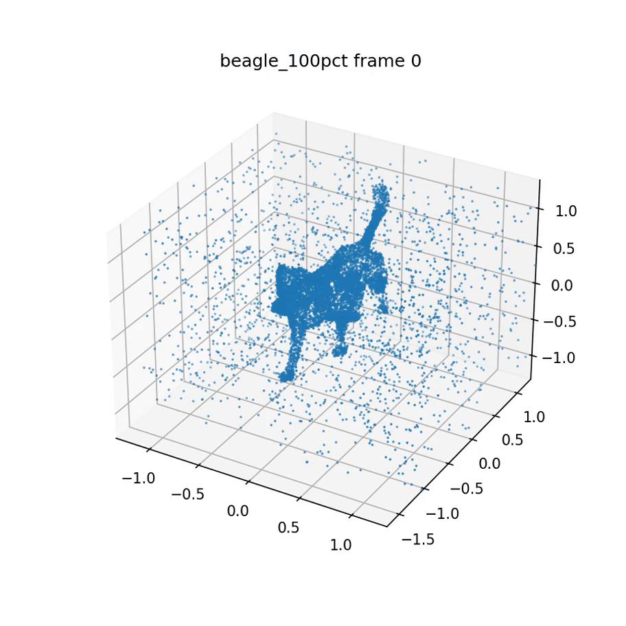
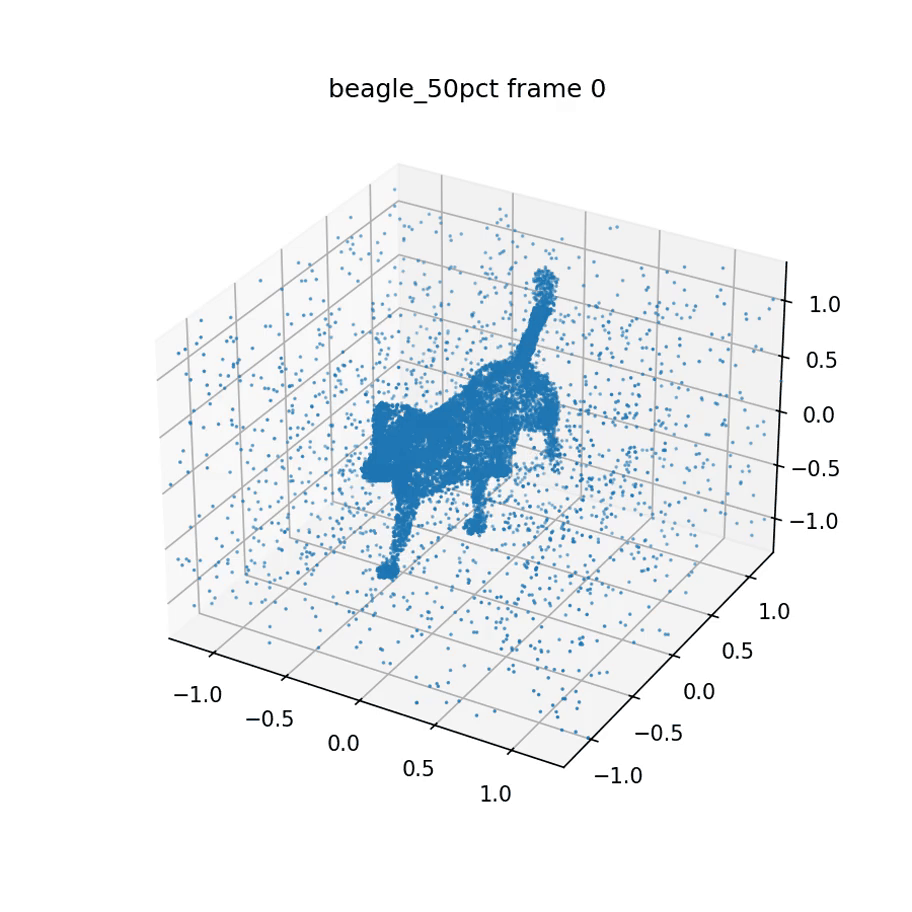
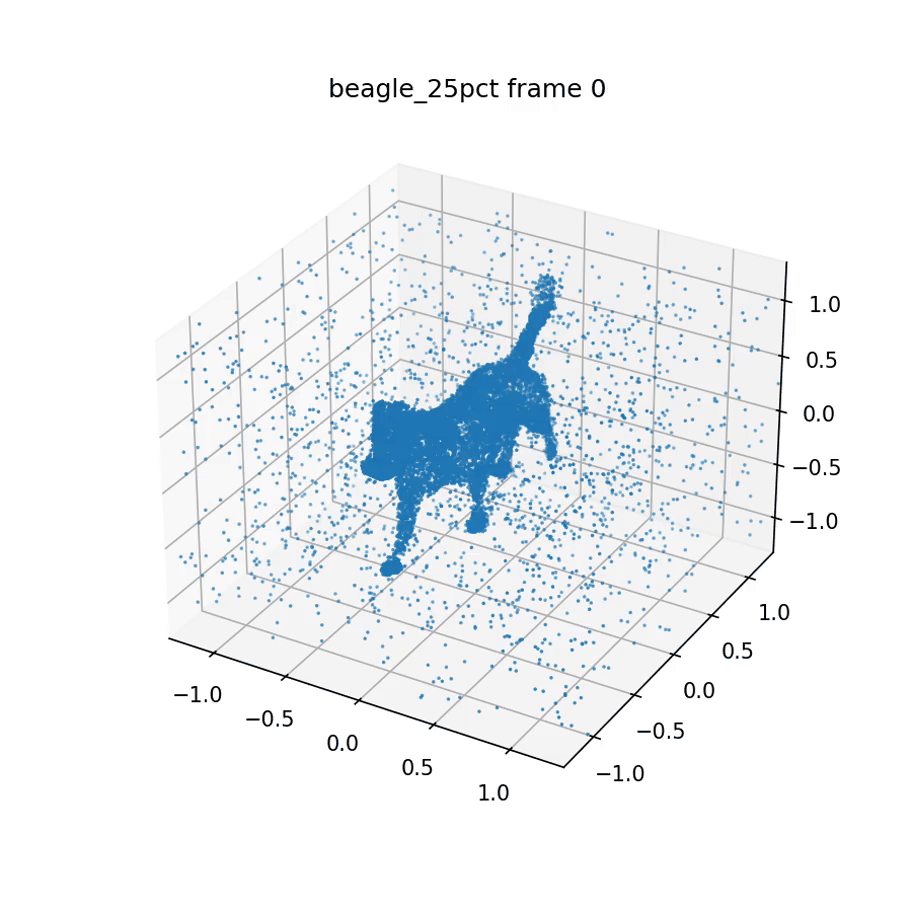
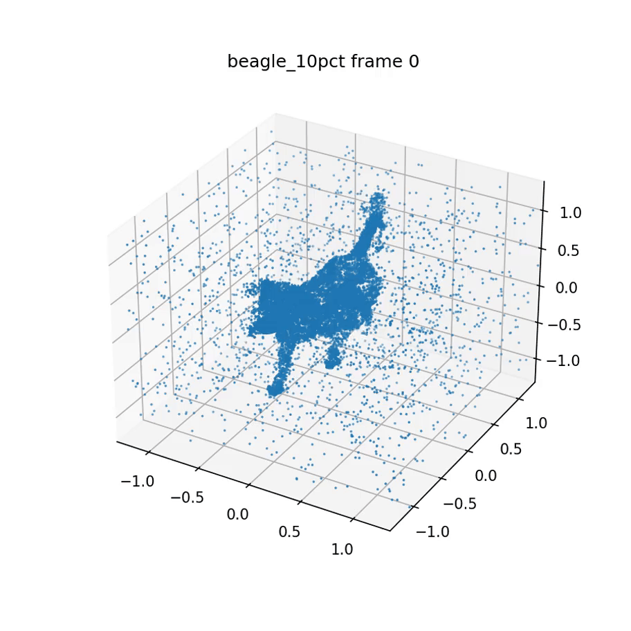

# Исследование влияния временного разрежения данных на 4D Gaussian Splatting

## 1. Описание исследования

Данное тестовое задание представляет собой экспериментальный анализ поведения
4D Gaussian Splatting модели при уменьшении количества временных наблюдений.

Исследование выполнено на основе официальной реализации
4D Gaussian Splatting (Wu et al., CVPR 2024).

Цель работы — изучить, насколько устойчиво 4D представление динамической сцены
при ограниченном количестве временных кадров и как изменение временной информации
влияет на качество реконструкции и динамику Gaussian-примитивов.

## 2. Исследовательский вопрос

Основной вопрос исследования:

> Насколько устойчиво 4D Gaussian Splatting представление динамической сцены
> при уменьшении количества доступных временных кадров?

В рамках работы исследуется, как сокращение временной информации влияет на:

- качество реконструкции сцены;
- количество используемых Gaussian-элементов;
- характер временных деформаций;
- способность модели сохранять корректное движение объекта.

## 3. Гипотеза

При уменьшении количества входных временных кадров различные компоненты
4D Gaussian Splatting представления могут иметь разную устойчивость к потере
временной информации.

Предполагается, что модель способна сохранять высокое качество визуальной
реконструкции даже при сокращении количества наблюдений, однако её динамическая
составляющая будет более чувствительна к уменьшению временного разрешения данных.

Основной вопрос:

> Может ли 4D Gaussian Splatting продолжать создавать визуально качественное
> представление объекта при недостаточном количестве временных кадров, и как
> при этом изменяется его способность описывать динамику сцены?

Для проверки гипотезы сравнивались два аспекта 4D представления:

- качество визуальной реконструкции, оцениваемое с помощью PSNR, SSIM и LPIPS;
- изменение внутренней динамики Gaussian-элементов, анализируемое по их
  пространственным траекториям во времени.

## 4. Методика исследования

В качестве основы использована официальная реализация
4D Gaussian Splatting (Wu et al., CVPR 2024).

Исследование проводилось в несколько этапов:

1. Обучение 4D Gaussian Splatting модели на динамической сцене.
2. Изменение количества доступных временных кадров для создания различных
   уровней временного разрежения данных.
3. Оценка качества визуальной реконструкции.
4. Анализ временной динамики Gaussian-элементов сцены.

Для экспериментов использовалась динамическая сцена **Beagle** из внешнего
набора данных.

В исследовании сравнивались четыре варианта временного представления данных:

| Вариант | Количество входных кадров |
|---|---:|
|100%|200|
|50%|100|
|25%|50|
|10%|20|

Таким образом, эксперимент позволяет оценить влияние постепенного уменьшения
временной информации на два аспекта 4D представления:

- сохранение визуального качества реконструкции;
- сохранение корректной динамики движения объекта.

## 5. Данные и экспериментальная настройка

В качестве тестовой динамической сцены использовалась последовательность
**Beagle**, содержащая движущийся объект в течение временной последовательности
кадров.

Для проверки влияния количества временных наблюдений исходная последовательность
была искусственно разрежена. Были сформированы четыре варианта входных данных с
различным количеством кадров:

| Эксперимент | Количество кадров | Описание |
|---|---:|---|
|beagle_100pct|200|Полная временная последовательность|
|beagle_50pct|100|Используется половина кадров|
|beagle_25pct|50|Используется четверть кадров|
|beagle_10pct|20|Сильно разреженная последовательность|

Для каждого варианта отдельно обучалась 4D Gaussian Splatting модель.

После обучения для каждой модели сохранялись:

- итоговое качество реконструкции;
- количество Gaussian-элементов сцены;
- временные траектории Gaussian-элементов;
- статистика движения.

Для анализа динамики сцены были рассчитаны траектории 
пространственного положения Gaussian-элементов в различные моменты времени.

## 6. Метрики оценки

Для проверки гипотезы использовались две группы показателей:

### 6.1. Качество визуальной реконструкции

Для оценки сохранения качества изображения использовались стандартные метрики:

- **PSNR (Peak Signal-to-Noise Ratio)** — оценивает уровень соответствия между
  восстановленным изображением и исходным кадром. Более высокое значение
  указывает на лучшее качество реконструкции.

- **SSIM (Structural Similarity Index)** — оценивает сохранение структурной
  информации изображения и визуального сходства.

- **LPIPS (Learned Perceptual Image Patch Similarity)** — оценивает
  перцептивное сходство изображений с использованием признаков глубоких
  нейронных сетей. Более низкое значение соответствует лучшему результату.

---

### 6.2. Анализ временной динамики

Для оценки способности модели сохранять движение сцены использовались
извлечённые траектории Gaussian-элементов.

Были рассчитаны:

- **среднее смещение** — средняя величина изменения положения Gaussian-элементов
  относительно начального состояния;

- **максимальное смещение** — максимальное наблюдаемое изменение положения;

- **доля движущихся Gaussian-элементов** — количество элементов, у которых
  наблюдалось изменение положения во времени.

Таким образом, эксперимент позволяет отдельно оценить:

1. насколько хорошо модель сохраняет внешний вид объекта;
2. насколько хорошо модель сохраняет его динамическое поведение.

## 7. Результаты эксперимента

### 7.1. Влияние временного разрежения на качество реконструкции

Первым этапом было исследовано влияние уменьшения количества входных кадров
на качество визуального восстановления сцены.

Результаты показывают, что умеренное сокращение временных данных практически
не влияет на качество реконструкции. При уменьшении количества кадров с 200
до 100 наблюдается сохранение значений PSNR, SSIM и LPIPS на близком уровне.

Однако при сильном временном разрежении (20 кадров) происходит заметное
ухудшение качества восстановления.

| Эксперимент | Кадры | PSNR | SSIM | LPIPS |
|---|---:|---:|---:|---:|
|beagle_100pct|200|33.9677|0.9702|0.0548|
|beagle_50pct|100|33.9266|0.9711|0.0519|
|beagle_25pct|50|32.7479|0.9675|0.0558|
|beagle_10pct|20|28.1411|0.9485|0.0743|

#### PSNR

#### SSIM

#### LPIPS

### 7.2. Анализ сохранения динамики сцены

Вторым этапом исследовалось влияние временного разрежения на способность модели
восстанавливать движение объекта.

Для этого были проанализированы траектории Gaussian-элементов,
полученные после обучения каждой модели.

В отличие от метрик качества изображения, анализ движения показывает изменение
внутреннего поведения 4D представления сцены.

Были рассчитаны:

- среднее смещение Gaussian-элементов;
- максимальное смещение;
- количество элементов, изменяющих своё положение.

## 8. Проверка гипотезы и обсуждение результатов

Проведённый эксперимент показывает, что уменьшение количества временных кадров
оказывает различное влияние на визуальную и динамическую составляющие
4D Gaussian Splatting представления.

Анализ качества реконструкции показывает, что модель сохраняет устойчивость при
умеренном сокращении временной информации. При переходе от полной последовательности
(200 кадров) к половине данных (100 кадров) значения PSNR, SSIM и LPIPS практически
не изменяются, что указывает на сохранение визуального качества сцены.

При дальнейшем уменьшении количества кадров наблюдается заметная деградация
качества, особенно для наиболее разреженного варианта (20 кадров).

Анализ динамической составляющей показывает, что изменение количества временных
наблюдений влияет на внутреннее поведение Gaussian-представления сцены.
Траектории Gaussian-элементов демонстрируют различия между моделями,
обученными на разном количестве кадров, что указывает на зависимость
динамического представления от доступной временной информации.

Таким образом, результаты подтверждают основную гипотезу: визуальная реконструкция
и динамическое представление обладают различной устойчивостью к сокращению
временных данных.

При этом следует учитывать ограничение эксперимента: анализ движения основан на
изменении пространственного положения Gaussian-элементов внутри модели и не
представляет собой прямую оценку ошибки относительно истинной траектории объекта.

## 9. Визуализация движения

Для дополнительного анализа динамической составляющей 4D Gaussian Splatting была
выполнена визуализация изменения положения Gaussian-элементов сцены во времени.

Для каждого варианта временного разрежения были построены последовательности,
отражающие изменение пространственного положения Gaussian-элементов на протяжении
временной последовательности.

Полученные визуализации позволяют сравнить, как изменение количества входных
кадров влияет на динамическое представление модели.

### Полная временная информация (100% кадров)

### 50% входных кадров

### 25% входных кадров

### 10% входных кадров

## 10. Ограничения исследования

Несмотря на полученные результаты, эксперимент имеет несколько ограничений.

Во-первых, исследование проводилось на одной динамической сцене Beagle,
поэтому результаты могут зависеть от особенностей конкретного объекта и его движения.

Во-вторых, анализ динамики основывался на изменении положения Gaussian-элементов
внутри модели и не является прямой оценкой ошибки восстановления движения
относительно истинной траектории объекта.

